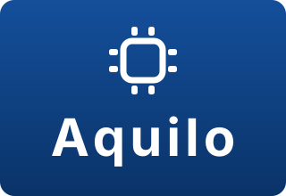

<p align="center">
  
</p>

# Aquilo Septic Tank Monitor for Home Assistant

[](https://my.home-assistant.io/redirect/hacs_repository/?owner=RoSulek1&repository=Aquilo-Home-Assistant-Custom-Component&category=integration)

[](https://github.com/hacs/integration)
[](https://github.com/RoSulek1/Aquilo-Home-Assistant-Custom-Component/releases)
[](LICENSE)

Home Assistant custom component for the **Aquilo Septic Tank & Water Level Monitor** (Czujnik poziomu szamba i wody Aquilo).

This integration replaces manual YAML REST and template sensors with a native **UI Config Flow**, automatic device discovery, and clean sensor entities with proper device classes, units, and timestamps.

---

## ✨ Features

- **Zero-YAML Setup:** Configure directly in Home Assistant via **Settings → Devices & Services**.
- **Real-Time Data Polling:** Automatically queries `http://<DEVICE_IP>/state`.
- **Preconfigured Sensor Entities:**
  - 📏 **Level / Poziom (`cm`):** Liquid distance / height with `SensorDeviceClass.DISTANCE` and state class `measurement`.
  - 💧 **Fill Percentage / Procent (`%`):** Tank fill percentage with `measurement` class.
  - 🕒 **Last Read / Ostatni odczyt:** Real timestamp with `SensorDeviceClass.TIMESTAMP`.
  - ⏱️ **Time Since Last Read / Czas od odczytu (`min`):** Calculated minutes elapsed since the sensor took the last measurement.
- **Unified Device Registry:** All entities are grouped under a single Aquilo device card with a link to the device's web interface.
- **Options Flow:** Adjust polling interval anytime without reinstalling.
- **Bilingual Support:** Full English and Polish (`pl`) translations.

---

## 🚀 Installation

### Option 1: Via HACS (Recommended)

1. Click the **Add to My Home Assistant** button:

   [](https://my.home-assistant.io/redirect/hacs_repository/?owner=RoSulek1&repository=Aquilo-Home-Assistant-Custom-Component&category=integration)

2. Or manually in HACS:
   - Open **HACS** in your Home Assistant.
   - Click the three dots in the top right corner and select **Custom repositories**.
   - Paste repository URL: `https://github.com/RoSulek1/Aquilo-Home-Assistant-Custom-Component`
   - Select Type: **Integration**
   - Click **Add**, find **Aquilo Septic Tank Monitor**, and click **Download**.
3. **Restart Home Assistant**.

---

### Option 2: Manual Installation

1. Download the latest release ZIP from the [Releases](https://github.com/RoSulek1/Aquilo-Home-Assistant-Custom-Component/releases) page.
2. Copy the `custom_components/aquilo` directory into your Home Assistant `<config>/custom_components/` folder:
   ```
   config/
   └── custom_components/
       └── aquilo/
           ├── __init__.py
           ├── manifest.json
           ├── config_flow.py
           ├── coordinator.py
           ├── sensor.py
           ├── const.py
           ├── strings.json
           └── translations/
               ├── en.json
               └── pl.json
   ```
3. Restart Home Assistant.

---

## ⚙️ Configuration

1. In Home Assistant, navigate to **Settings** → **Devices & Services**.
2. Click **Add Integration** in the bottom right.
3. Search for **Aquilo** (or **Aquilo Septic Tank Monitor**).
4. Enter the required parameters:
   - **Device IP or Hostname:** e.g., `192.168.1.150` (or `aquilo.local`)
   - **Tank Name:** Friendly name (e.g. `Szambo` or `Septic Tank`)
   - **Update Interval:** Default `60` seconds
5. Click **Submit**. Home Assistant will test connection to the device and create your entities automatically!

---

## 📡 Hardware / REST API Reference

The integration connects via HTTP to the device endpoint:

```http
GET http://192.168.X.XXX/state
```

Expected JSON response from the Aquilo device:

```json
{
  "sensors": [
    {
      "id": "aquilo_tank_1",
      "lvl": 145,
      "pct": 72,
      "lstRead": "2026-10-17 14:05:00"
    }
  ]
}
```

---

## 📊 Dashboard Lovelace Examples

### Gauge Card (Fill Level)

```yaml
type: gauge
entity: sensor.szambo_procent
name: Poziom szamba
needle: true
severity:
  green: 0
  yellow: 70
  red: 85
```

### Full Tank Alert Automation

```yaml
alias: "Alert: Septic Tank almost full (>85%)"
trigger:
  - platform: numeric_state
    entity_id: sensor.szambo_procent
    above: 85
action:
  - service: notify.notify
    data:
      title: "⚠️ Septic Tank Warning"
      message: "Septic tank fill level has reached {{ states('sensor.szambo_procent') }}% ({{ states('sensor.szambo_poziom') }} cm)!"
mode: single
```

---

## 📄 License

This project is licensed under the [Apache 2.0 License](LICENSE).
